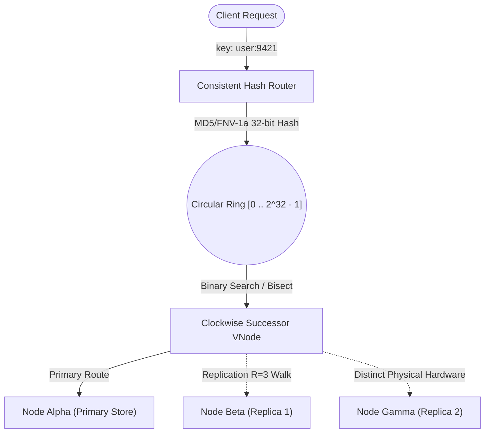

# Consistent Hashing Lab & Interactive Ring Visualizer

An interactive Dockerized demonstration and educational laboratory exploring **Consistent Hashing**, virtual token rings (vnodes), replication topologies, and key migration dynamics in distributed systems.

Open [architecture.html](architecture.html) for the deep-dive theoretical guide, mathematical proofs, and failure scenario walkthroughs. Launch the interactive visualizer at `http://localhost:8004/demo`.

---

## Architecture & Ring Dynamics



### The Problem it Solves
Traditional modulo hashing (`hash(key) % N`) causes **catastrophic cache invalidation** whenever servers are added or removed:
$$\text{Churn Rate (Modulo)} = \frac{N}{N + 1} \approx 80\% \text{ to } 95\%$$

With **Consistent Hashing**:
$$\text{Churn Rate (Consistent Ring)} \approx \frac{1}{N + 1} \approx 15\% \text{ to } 20\%$$
Only keys directly adjacent to the modified node migrate, protecting backend databases from thundering herds.

---

## Features

- **Interactive $360^\circ$ Hash Ring Visualizer:** Real-time SVG canvas displaying the full $[0, 2^{32} - 1]$ space, partition arc boundaries, and virtual node distributions.
- **Dynamic Key Tracer & Animated Rays:** Watch key hashes compute live, shoot out to their angular position on the circle, and travel clockwise to their responsible node.
- **Virtual Nodes (VNodes):** Configurable tokens per node ($V=100-256$) to eliminate partition skew and hot shards.
- **Replication Quorums ($R=3$):** Clockwise walk guaranteeing distinct physical nodes for replicas.
- **Comparative Simulation Lab:** Side-by-side benchmark comparing **Simple Modulo**, **Consistent Hashing (1 VNode)**, and **Consistent Hashing (150 VNodes)** across 10,000 keys.
- **Live Migration Ledger:** Real-time stream recording rebalanced keys whenever nodes join or leave the cluster.

---

## Quick Start

### 1. Requirements
- Docker & Docker Compose (or Python 3.10+)

### 2. Run with Docker Compose
```sh
cd consistent-hashing
cp .env.example .env
docker compose up --build
```

Access the lab in your browser:
- **Interactive Ring Visualizer:** [http://localhost:8004/demo](http://localhost:8004/demo)
- **Architecture & Theory Guide:** [http://localhost:8004/architecture](http://localhost:8004/architecture)
- **Health / Readiness:** [http://localhost:8004/healthz](http://localhost:8004/healthz)

### 3. Run Locally with Python Virtual Environment
```sh
cd consistent-hashing
python3 -m venv .venv
source .venv/bin/activate
pip install -r requirements.txt
uvicorn app.main:app --host 0.0.0.0 --port 8004 --reload
```

---

## REST API Reference

| Endpoint | Method | Description |
|---|---|---|
| `GET /api/ring/state` | GET | Current cluster topology, active nodes, vnode samples, partition percentages |
| `POST /api/ring/nodes` | POST | Add a physical node (`node_id`, `label`, `weight`, `vnodes`, `color`) |
| `DELETE /api/ring/nodes/{id}` | DELETE | Remove node and reassign keys to clockwise successors |
| `POST /api/ring/keys` | POST | Store a key and return routing diagnostics |
| `GET /api/ring/keys/{key}` | GET | Look up key, calculate 32-bit hash, angle in degrees, primary and replica nodes |
| `POST /api/ring/populate` | POST | Bulk inject keys (e.g. 500, 1000) to observe statistical distribution |
| `POST /api/ring/clear-keys` | POST | Clear stored keys |
| `POST /api/ring/reset` | POST | Reset topology to the default 4 nodes |
| `POST /api/benchmark` | POST | Run 10,000 key comparative benchmark (Modulo vs Basic vs VNodes) |

---

## Automated Tests

Run the test suite verifying mathematical churn bounds, boundary wrap-around, and API contracts:

```sh
# Via Docker
docker compose --profile test run --build --rm tests

# Or locally
pytest tests/ -v
```

Stop the service:
```sh
docker compose down
```
