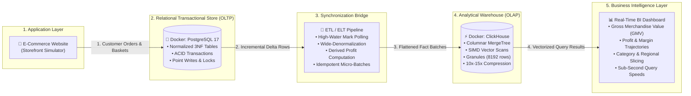

# E-Commerce OLTP to OLAP System Architecture Lab

An interactive Dockerized demonstration and educational laboratory exploring **Dual-Database Systems Design**: decoupling transactional **Online Transaction Processing (OLTP)** in PostgreSQL from analytical **Online Analytical Processing (OLAP)** in ClickHouse via an incremental **ETL / ELT Pipeline**, complete with a real-time **BI Dashboard** and comparative query benchmarks.

Open [architecture.html](architecture.html) for the deep-dive theoretical guide and storage mechanics. Launch the interactive dashboard at `http://localhost:8005/dashboard`.

---

## Architecture Topology



---

## How the Architecture Works

### 1. Application: E-Commerce Website
The application layer simulates a high-traffic e-commerce storefront. Customers place orders with multi-item shopping carts across various product categories (Electronics, Apparel, Home & Kitchen, Sports, Books).
- Generates live checkouts, payment methods (Credit Card, PayPal, Apple Pay, Crypto), and promotional discounts.
- Includes a traffic surge generator (simulating Black Friday spikes of 50 to 2,500 concurrent orders).

### 2. Docker Container — PostgreSQL (OLTP)
Stores live orders in a 3NF normalized relational schema:
- **`customers`**: User profiles, loyalty segments (VIP, Regular, New, At-Risk), shipping countries.
- **`products`**: Product catalog, unit prices, manufacturing cost, inventory stock.
- **`orders`**: Transaction header, payment status, currency, timestamps.
- **`order_items`**: Line items, quantities, line totals, discounts applied.
- **Role**: Provides strict ACID guarantees, row-level locking for inventory integrity, and sub-millisecond point reads/writes.

### 3. ETL / ELT Pipeline (Moves and Transforms Data)
Bridges the transactional store and the analytical warehouse:
- **Extract**: Queries PostgreSQL for all orders created or updated since the last high-water mark recorded in `sync_checkpoint` (`WHERE o.id > :last_synced_order_id`).
- **Transform**: Flattens normalized tables into wide analytical events and computes derived business metrics:
  $$\text{profit} = \text{line\_total} - (\text{cost\_price} \times \text{quantity})$$
  Also normalizes timestamps to `YYYY-MM-DD` for partition pruning.
- **Load**: Batch-inserts wide events into ClickHouse `analytics.sales_fact`.
- **Idempotency**: Uses ClickHouse `ReplacingMergeTree(synced_at)` so that order updates (e.g. from `PENDING` to `PAID`) are deduplicated automatically during background part merges.

### 4. Docker Container — ClickHouse (OLAP)
Column-oriented analytical database designed for blazing aggregations:
- **Columnar Storage**: Each attribute is stored in a separate compressed file (`.bin` and `.mrk`). Aggregation queries read only the required columns, bypassing unneeded data.
- **Sparse Primary Key**: Instead of one index entry per row, ClickHouse stores one index mark per **granule** (8,192 rows), allowing multi-million row tables to fit their primary index in CPU L3 cache.
- **Vectorized Execution**: Evaluates expressions using SIMD instructions, processing 64–256 rows per CPU cycle.

### 5. BI Dashboard (Revenue, Trends, and Business Insights)
An executive analytics dashboard consuming ClickHouse:
- **Executive KPIs**: Real-time GMV, Net Profit, Total Orders Placed, Average Order Value (AOV), and Gross Margin %.
- **Time Series Trends**: Daily revenue and profit trajectories.
- **Category Breakdown**: Dynamic revenue and item volume distribution.
- **Geographic Heatmap**: Country sales performance.
- **Customer Loyalty Segments**: RFM segmentation matrix.

### 6. Side-by-Side Performance Benchmark Arena
Directly tests PostgreSQL (Row-Scan with Relational JOINs) against ClickHouse (Columnar Vector Scan) on identical analytical queries:
- Demonstrates **10x to 100x speedups** and explains the underlying storage engine and I/O differences.

---

## Quick Start

### 1. Prerequisites
- Docker & Docker Compose (or Python 3.10+)

### 2. Run with Docker Compose
```sh
cd ecommerce-oltp-olap
cp .env.example .env
docker compose up --build
```

Access the lab in your browser:
- **Interactive BI Dashboard & Storefront:** [http://localhost:8005/dashboard](http://localhost:8005/dashboard)
- **"How the Architecture Works" Theory Guide:** [http://localhost:8005/architecture](http://localhost:8005/architecture)
- **Health / Readiness:** [http://localhost:8005/readyz](http://localhost:8005/readyz)

### 3. Run Locally (Zero Docker Dependency Mode)
The application includes automatic in-memory SQLite and vectorized columnar engine fallbacks, allowing instant local testing without Docker:
```sh
cd ecommerce-oltp-olap
python3 -m pip install -r requirements.txt
python3 -m uvicorn app.main:app --port 8005 --reload
```

---

## Port Allocation

| Component | Container Port | Host Port | Protocol | Description |
| :--- | :--- | :--- | :--- | :--- |
| **App / Dashboard** | `8005` | `8005` | HTTP | FastAPI + Storefront + BI UI |
| **PostgreSQL** | `5432` | `5434` | TCP / PG | OLTP Database |
| **ClickHouse HTTP** | `8123` | `8124` | HTTP | OLAP Query Interface |
| **ClickHouse Native** | `9000` | `9001` | TCP | Native Binary Protocol |

---

## API Reference

### Storefront & OLTP
- `GET /api/catalog/products`: List available products and stock.
- `GET /api/catalog/customers`: List registered customers.
- `POST /api/orders`: Place a transactional order in PostgreSQL.
- `GET /api/orders/recent`: Inspect recent normalized orders.
- `POST /api/orders/simulate`: Generate $N$ realistic orders.

### ETL / ELT Pipeline
- `POST /api/pipeline/sync`: Trigger manual incremental batch sync.
- `GET /api/pipeline/status`: Retrieve high-water mark, backlog, and sync logs.
- `POST /api/pipeline/autoloop`: Enable/disable background auto-sync worker.

### ClickHouse OLAP Analytics
- `GET /api/analytics/overview`: Gross GMV, profit, orders, AOV, margin %.
- `GET /api/analytics/trends`: Time-series revenue by day.
- `GET /api/analytics/categories`: Aggregations grouped by product category.
- `GET /api/analytics/regions`: Sales breakdown by customer country.
- `GET /api/analytics/segments`: Metrics by customer loyalty tier.

### Benchmark
- `POST /api/benchmark/run`: Execute head-to-head OLTP vs OLAP race.

---

## Running Automated Tests

Run the complete test suite:
```sh
docker compose --profile test run tests
```
Or locally with pytest:
```sh
pytest -v
```
