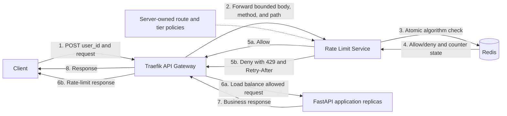

# Gateway Rate Limiter

A local, Docker Compose rate-limiting example. Traefik is the API gateway and load balancer. It asks a dedicated FastAPI rate-limit service to check each request before sending allowed traffic to FastAPI application replicas. Only the rate-limit service can access Redis.

Open [architecture.html](architecture.html) for the visual architecture guide and operating walkthrough.

## Architecture and request flow



1. The client sends a JSON request containing `user_id` to the gateway.
2. Traefik's ForwardAuth middleware forwards the request body, method, and path to the rate-limit service. The body is capped at 64 KiB.
3. The rate-limit service validates `user_id`, selects a server-configured policy, and runs the selected atomic Redis operation.
4. Redis returns the decision and current counter state. If Redis is unavailable, the protected request fails closed with `503`.
5. An allowed request continues through Traefik to one of the application replicas. A denied request gets `429 Too Many Requests` and `Retry-After`; it never reaches an application replica.

The rate-limit service is attached to both the edge network and a private Redis network. Application replicas and Traefik have no Redis-network connection. The local Traefik container mounts the Docker socket for service discovery; use an appropriate service-discovery configuration in production.

## Algorithms and policies

The demo exposes three POST routes. Algorithm choice and limits are server-side in `app/policies.py`; callers cannot select their own policy.

| Route | Algorithm | Basic tier | Premium demo user |
| --- | --- | --- | --- |
| `/v1/fixed` | Fixed window | 5 requests per 60 seconds | 10 requests per 60 seconds |
| `/v1/sliding` | Exact sliding-window log | 5 requests per 60 seconds | 10 requests per 60 seconds |
| `/v1/token` | Token bucket | Capacity 5, refill 5 tokens per minute | Capacity 10, refill 10 tokens per minute |

The fixed window starts with the first request for a key. The exact sliding-window log is precise but stores one Redis sorted-set entry per allowed request during the active window, so high-volume production use may favor a sliding-window counter. Lua scripts make each decision atomic across service instances.

The sample tier map is server-owned demo configuration, not authentication. A production deployment must authenticate the caller and verify that payload `user_id` matches the authenticated identity; otherwise users can spoof IDs or claim another tier. JWT validation is intentionally outside this starter's scope.

## Run locally

Requirements: Docker Desktop with Docker Compose.

```sh
docker compose up --build --scale app=3
```

The API gateway listens on `http://localhost:8080`. The application and limiter ports are not published directly. Redis is also not published to the host.

Try an algorithm route (replace `fixed` with `sliding` or `token`):

```sh
curl -i http://localhost:8080/v1/fixed \
  -H 'Content-Type: application/json' \
  -d '{"user_id":"demo-user-1","message":"hello"}'
```

Repeat the request six times within the window to see `429 Too Many Requests` and a `Retry-After` header. The response body identifies which application replica served an allowed request.

The application liveness endpoint is `http://localhost:8080/healthz`. The rate-limit service's `/healthz` and Redis-checking `/readyz` are internal Compose health checks; its port is not published to the host.

## Tests

Run the Redis-backed tests in Compose:

```sh
docker compose --profile test run --rm tests
```

These tests cover algorithm limits, per-user key isolation, server-side tier selection, concurrent requests sharing one Redis counter, and the fail-closed response when Redis is unavailable.

Stop the local stack with `Ctrl+C`, or run `docker compose down` after it was started in the background.