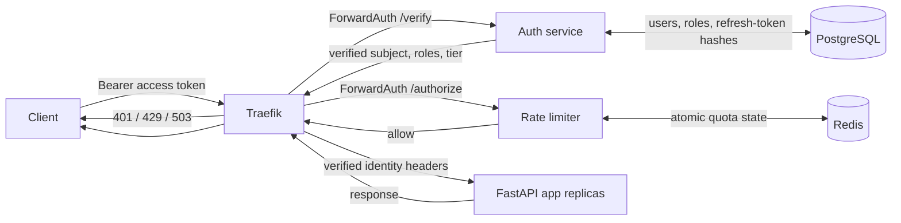

# Protected API Gateway

A local Docker Compose system with a Python authentication service, PostgreSQL user store, Traefik gateway, Redis-backed rate limiter, and FastAPI application replicas. Open [architecture.html](architecture.html) for the solution diagram and request-flow guide.

## Architecture and trust flow



For protected `/v1/*` routes, Traefik runs authentication before rate limiting. The auth service validates the JWT and account state, reads current roles and tier from PostgreSQL, and returns trusted identity headers. Traefik overwrites any client-supplied versions. The limiter keys quotas by verified subject and server-controlled tier; it never trusts body `user_id`. Requests rejected by auth or quota checks do not reach app replicas.

Networks are separated: Traefik bridges the public edge and app-edge networks; app replicas join only app-edge; auth joins edge and auth-backend; the limiter joins edge and rate-limit-backend. PostgreSQL and Redis have no published host ports. Auth/SQL and Redis failures fail closed.

## Auth API

| Endpoint | Purpose |
| --- | --- |
| `POST /auth/signup` | Create a basic user and return access/refresh tokens |
| `POST /auth/login` | Verify credentials and return tokens |
| `POST /auth/refresh` | Rotate a refresh token; replay revokes its token family |
| `POST /auth/logout` | Revoke a refresh token |
| `GET /auth/me` | Return the authenticated user, roles, and permissions |
| `GET /auth/admin/users` | List users; requires `users:read` permission |

Access JWTs expire after 15 minutes. Refresh tokens are opaque, stored only as hashes, and expire after 14 days. Passwords use Argon2id. Public signup cannot choose roles or tiers; new accounts receive the `user` role and `basic` tier.

## Run locally

Requirements: Docker Desktop with Compose. From this directory, create local secrets before starting:

```sh
cp .env.example .env
openssl rand -hex 32
```

Put the generated value in `.env` as `AUTH_JWT_SECRET`; set `AUTH_DB_PASSWORD` to a strong alphanumeric password. The `.env` file is ignored by Git. Replace local values with managed secrets for any deployed environment.

```sh
docker compose up --build --scale app=3
```

Traefik listens on `http://localhost:8080`. PostgreSQL and Redis are internal only. On first start, auth applies Alembic migrations before serving requests.

Create an account and use its access token for a protected request:

```sh
ACCESS_TOKEN=$(curl -s http://localhost:8080/auth/signup \
  -H 'Content-Type: application/json' \
  -d '{"email":"reader@example.com","password":"a-long-local-password"}' \
  | python3 -c 'import json,sys; print(json.load(sys.stdin)["access_token"])')

curl -i http://localhost:8080/v1/fixed \
  -H "Authorization: Bearer $ACCESS_TOKEN" \
  -H 'Content-Type: application/json' \
  -d '{"message":"hello"}'
```

Repeat the protected request six times within 60 seconds to observe the basic tier's `429 Too Many Requests` response and `Retry-After` header. Try `/v1/sliding` and `/v1/token` for the other algorithms. `/healthz` is the application liveness route.

Promote an existing account to admin as an operator:

```sh
docker compose exec auth-service python -m auth_service.bootstrap_admin reader@example.com
```

This grants the seeded `admin` role, which includes `users:read`. For a premium rate-limit tier, update the account through the private database as an operator; the client cannot request or supply this tier.

## Tests

```sh
docker compose --profile test run --build --rm auth-tests
docker compose --profile test run --build --rm tests
```

Auth API/security tests use isolated SQLite fixtures. Rate-limiter integration tests use Compose Redis and cover atomic limits, principal isolation, policies, and fail-closed behavior.

Use `docker compose down` to stop the stack; the PostgreSQL volume is retained.